# SHMEM Usage Restrictions

1. High-level RMA operations of GM2GM use the default buffer, and concurrent operations are not supported. Otherwise, data may be overwritten. If concurrent operations are required, it is recommended that you use low-level APIs.
2. The barrier API must currently be used in the Mix Kernel (including mmad and GM2UB/UB2GM operations). For details, see the example. This restriction will be removed after the compiler is updated.
3. Before using the high-level RDMA APIs, use the `aclshmemx_rdma_config` API to configure the UB Buffer, sync_id, and other information. Ensure that the reserved UB Buffer size is greater than or equal to 128 bytes. If not configured, the default UB Buffer at 190 KB and EVENT_ID0 are used as the internal synchronization EVENT_ID of the APIs. The RDMA-related APIs use `PipeBarrier<PIPE_MTE3>` internally to block the MTE3 pipeline and ensure that RDMA tasks are delivered. For the dedicated RDMA-engine Put/Get APIs, both `src` and `dst` must point to the symmetric memory, and each complete transfer range must not exceed its own memory allocation. The general Put/Get APIs still retain the standard RMA operand semantics. However, after RDMA is enabled through `ACLSHMEM_DATA_OP_ROCE`, the runtime may automatically select RDMA based on the target PE. Therefore, the caller must ensure in advance that both ends point to the symmetric memory, without checking which engine is actually used for a single call.
4. Before using the high-level SDMA APIs, use the `aclshmemx_sdma_config` API to configure the UB Buffer, sync_id, and other information. Ensure that the reserved UB Buffer size is greater than or equal to 64 bytes. If not configured, the default UB Buffer at 191 KB and EVENT_ID0 are used as the internal synchronization EVENT_ID of the APIs.
5. Before using the high-level UDMA APIs, you can use the `aclshmemx_set_udma_config` API to configure the UB Buffer, sync_id, and other information. Ensure that the reserved UB Buffer size is greater than or equal to 128 bytes. If not configured, the default UB Buffer at 189 KB and EVENT_ID0 are used as the internal synchronization EVENT_ID of the APIs. The high-level UDMA APIs deliver WQEs through `PIPE_MTE3` staging by default. This UB Buffer is used to temporarily store a complete WQE.
6. A2 16-card model: The NPUs are divided into a front-eight-card group and a rear-eight-card group, that is, two 8P Fullmesh groups. NPUs within each 8P group are fully interconnected through HCCS buses, and the two 8P Fullmesh groups are interconnected through the PCIe-SW. Therefore, MTE APIs cannot be directly used to transfer data between NPUs across groups. Some example cases use MTE transfer APIs. Do not specify NPUs across groups for a single-server case, to prevent unknown errors (such as a stream synchronization failure).
7. A3 functions such as D2H/D2rH: Ensure that the available space of the Host memory (DRAM) is greater than the `local_mem_size` allocated by each PE during initialization using `aclshmemx_init_attr_t`. The DRAM address range on the HCCS bus is fixed. In some environments, not all DRAM falls within the fixed HCCS bus address range. Only the intersection with the fixed HCCS bus addresses is available DRAM space. To check the available DRAM space, use `lsmem` to query the physical address range of the local host, and obtain the intersection with the following four address ranges (0x29580000000-0x34000000000, 0xa9580000000-0xb4000000000, 0x129580000000-0x134000000000, 0x1a9580000000-0x1b4000000000) to determine the actual available DRAM capacity. If there is no intersection, no available DRAM space exists or the available space is smaller than the configured `local_mem_size`. In this case, the function is not supported.

# SHMEM FAQs

## Memory Allocation

### aclshmem_malloc allocates asymmetric shared memory for multiple devices

#### Q: The operator precision is incorrect, no error log is generated, and the data accessed by the shared memory is abnormal

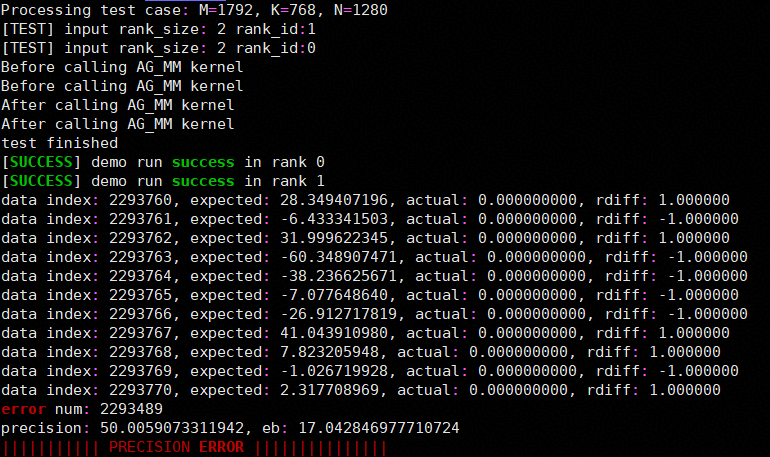

Incorrect sample code:

The following uses `sdma` in the `examples` directory as an example to describe a simple scenario of asymmetric shared memory allocation:

```cpp
// Inappropriate calling of aclshmem_malloc
void *symmTest = nullptr;
symmTest = aclshmem_malloc(((rank_id + 1) * 1024 * 1024) * sizeof(__fp16));

void *symmPtr = aclshmem_malloc((204 * 1024 * 1024) * sizeof(__fp16));
uint8_t *gmSymmetric = (uint8_t *)symmPtr;

... ...

aclshmem_free(symmPtr);
if (symmTest != nullptr) {
    aclshmem_free(symmTest);
}
```

#### A: You can use the debug mode to check the symmetry of shared memory allocation.

To enable the `debug` mode, run the following commands in the root directory of the code repository:

- A2/A3 platform: `bash scripts/build.sh -examples -debug`
- Ascend950 platform: `bash scripts/build.sh -soc_type Ascend950 -examples -debug`

The error message below is displayed when the code is executed. The error is caused by the use of the `aclshmem_malloc` API to allocate asymmetric shared memory.

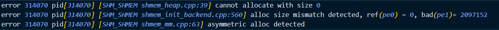

Diagram of the error cause analysis:

Rectification method: Ensure that each rank allocates the same size of shared memory.

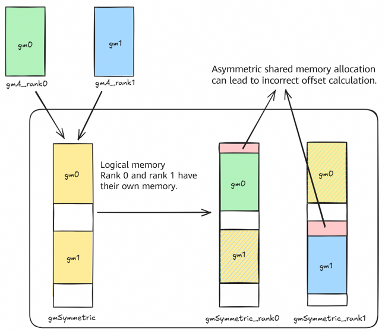

### aclshmemx_set_attr_uniqueid_args sets a different local_mem_size for each PE

#### Q: "local size diffs" is displayed

Incorrect code snippet:

```cpp
aclshmemx_init_attr_t attributes;
aclshmemx_uniqueid_t uid = ACLSHMEM_UNIQUEID_INITIALIZER;

int64_t local_mem_size = (1024 + pe * 2) * 1024 * 1024;
if (pe == 0) {
    status = aclshmemx_get_uniqueid(&uid);
}

MPI_Bcast(&uid, sizeof(aclshmemx_uniqueid_t), MPI_UINT8_T, 0, MPI_COMM_WORLD);
status = aclshmemx_set_attr_uniqueid_args(pe, pe_size, local_mem_size, &uid, &attributes);
status = aclshmemx_init_attr(ACLSHMEMX_INIT_WITH_UNIQUEID, &attributes);
```

Error log:

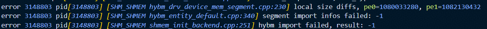

Note:

1. The difference of `6 MB` between the actually allocated size and the `local_mem_size` value in the log is the space used by the shmem framework.
2. The `local_mem_size` value here is aligned to `2 MB`. If you attempt to allocate another size, such as `1025 * 1024 * 1024`, a different error message may be displayed:

    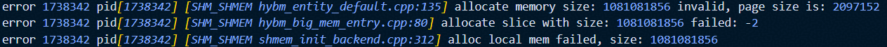

#### A: Ensure that the `local_mem_size` allocated to each PE is the same during the initialization of `aclshmemx_init_attr_t`.

## IP/PORT Configuration

### The bound port is occupied

#### Q: The IP address/port to be used has been occupied. The error log is shown in the figure

1. Error log indicating that the port is occupied:

    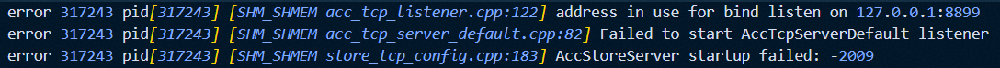

2. Error log indicating that the IP address is unavailable (1):

    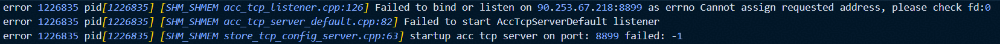

3. Error log indicating that the IP address is unavailable (2):

    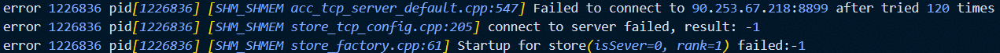

#### A: Check the availability of the IP address and port step by step

1. Check whether the IP address meets the expectation.
2. Check whether the port is occupied: `netstat -tuln | grep <port-number>`
3. Adjust the environment variable `SHMEM_UID_SESSION_ID` and the IP address and port number used by the actual executable file.

### Multiple initializations on the same port fail in default mode

#### Q: In default mode (`ACLSHMEMX_INIT_WITH_DEFAULT`), multiple initializations on the same port (for example, creating multiple instances in the same process, or repeatedly calling the initialization API without changing the port) report an error indicating that the port has been occupied

Error log features:

- `address in use for bind listen on ...` or `ACC_LINK_ADDRESS_IN_USE`
- `startup acc tcp server on port: ... already in use.`
- `bind failed` / `bind socket fail`

#### A: In default mode, each initialization binds an independent port. If the port has been occupied by the previous instance (not finalized), re-initialization fails due to the port conflict. Solutions

1. **Multi-instance scenario**: Set `SHMEM_INSTANCE_PORT_RANGE=start:end` and set the port in `ip_port` to `0` (for example, `tcp://127.0.0.1:0`). The framework automatically allocates `start_port + instance_id` as the actual port based on `instance_id`, ensuring that each instance uses a different port.
2. **Repeated initialization of a single instance**: Ensure that each initialization uses a different available port, or ensure that the previous initialization has completed `finalize` to release the port before the next initialization.

### Initialization fails when the IP address/port is not configured through environment variables and available network ports are automatically searched

#### Q: When neither `SHMEM_UID_SESSION_ID` nor `SHMEM_UID_SOCK_IFNAME` is configured, available network ports are automatically searched (both IPv4 and IPv6 are supported, excluding virtual interfaces such as lo/docker/veth/br-/virbr/tun/tap). The error log when the query fails is as follows

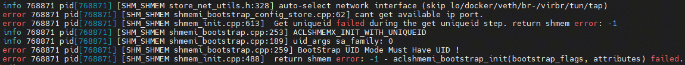

#### A: Manually configure available `SHMEM_UID_SESSION_ID` or `SHMEM_UID_SOCK_IFNAME`

Configuration examples:

- SHMEM_UID_SESSION_ID:

    `SHMEM_UID_SESSION_ID=127.0.0.1:1234`

    `SHMEM_UID_SESSION_ID=localhost:8888`
- SHMEM_UID_SOCK_IFNAME:

    `SHMEM_UID_SOCK_IFNAME=[6666:6666:6666:6666:6666:6666:6666:6666]:886`

    `SHMEM_UID_SOCK_IFNAME=enpxxxx:inet4` uses IPv4

    `SHMEM_UID_SOCK_IFNAME=enpxxxx:inet6` uses IPv6

    `SHMEM_UID_SOCK_IFNAME=eth0` automatically detects the available protocol (IPv4 preferred)

Note: If both are configured, only `SHMEM_UID_SESSION_ID` is read.

## RDMA

### Enabling the port bridge for communication on the same port

#### Q: Multiple NPUs on a single server share the same physical port of the 1825 NIC, and RDMA communication fails

#### A: In the multi-NPU scenario on a single server with the 1825 NIC, if multiple NPUs share the same physical port, the RDMA traffic between two NPUs is sent from that port and returns from the same port through the switch. The switch drops such **same-source same-destination packets** by default, causing communication failure. You need to enable the **port bridge** function on the corresponding switch interface

> For details: [Configuring the port bridge function](https://support.huawei.com/hedex/hdx.do?docid=EDOC1100558302&id=ZH-CN_TASK_0000001176744393)

**Procedure:**

1. Identify the switch ports connected to the NPUs. First, understand the physical cabling and clarify the mapping between NIC ports and NPU cards (that is, which NPUs share the same NIC port).

   **Common layout reference (8-card model):**

   | NPU card | NIC device |
   |--------|----------|
   | 0, 1   | hrn5_1   |
   | 2, 3   | hrn5_0   |
   | 4, 5   | hrn5_3   |
   | 6, 7   | hrn5_2   |

   For example, if NPUs 6 and 7 need to communicate with each other, they share the `hrn5_2` port. You need to enable the port bridge on the corresponding `hrn5_2` port of the switch.

   - Query network devices (the `net_dev` column) using `ibv_devinfo` or `hiroce5 gids`:

     ```bash
     ibv_devinfo
     # or
     hiroce5 gids
     ```

     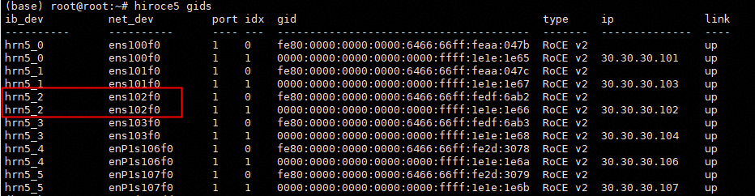

   - Query the MAC address of the corresponding interface using `ifconfig <net_dev>` or `ip link show <net_dev>`:

     ```bash
     ifconfig <net_dev>
     # or
     ip link show <net_dev>
     ```

     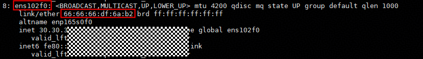

   - Query the corresponding switch port number based on the MAC address:

     ```bash
     display mac-address | include <mac-address>
     ```

     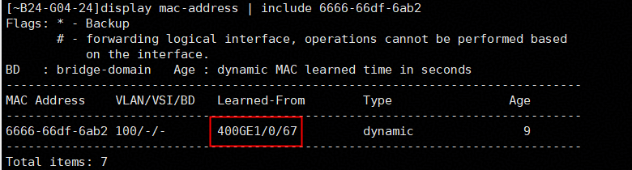

   > Note: In the preceding commands, `<net_dev>` must be replaced with the actual network device name queried in the previous step (such as `enp3s0`), and `<mac-address>` must be replaced with the actual MAC address queried in the previous step (in the format of `aabb-ccdd-eeff`).
   >
   > Note: To query the switch ports corresponding to NPUs 6 and 7 (sharing `hrn5_2`, port bridge required) or NPUs 5 and 6 (across `hrn5_3` and `hrn5_2`, port bridge not required), perform RDMA communication between the two NPU groups first (for example, run `rdma_demo`) so that the switch learns the corresponding MAC table entries. Otherwise, `display mac-address` may not return the corresponding records.

2. Log in to the switch and enter the system view: `system-view`
3. Enter the corresponding interface (100GE1/0/1 is used as an example; replace it with the actual one):

   ```bash
   interface 100GE1/0/1
   ```

4. Enable the port bridge:

   ```bash
   port bridge enable
   ```

5. Commit: `commit`
6. Verify: `display current-configuration | include port bridge`. The configuration succeeds if the output contains `port bridge enable`.
7. If multiple interfaces need to communicate on the same port, repeat steps 3 to 5 for each interface.

After the configuration is complete, run `rdma_demo` on the NPU cards using the same NIC port to verify whether the communication is normal.

### Communication packet loss

#### Q: After RDMA (RoCEv2) is enabled, packet loss occurs on the network

#### A: Check whether the TC and SL configurations on the switch and the device side are correct. Inconsistent configurations cause packet loss. For details about how to set the environment variables [HCCL_RDMA_TC](https://www.hiascend.com/document/detail/zh/canncommercial/900/maintenref/envvar/envref_07_0089.html) and [HCCL_RDMA_SL](https://www.hiascend.com/document/detail/zh/canncommercial/900/maintenref/envvar/envref_07_0090.html), see [Environment Variables](../api/env_vars_intro.md)

### RDMA port management rules

The RDMA V2 connection setup listening port of Ascend950 is automatically allocated by the system. You do not need to configure the RDMA connection setup port.

- When multiple processes or multiple SHMEM instances are started on the same RDMA IP address, you do not need to manually allocate an RDMA connection setup port for each process.
- The RDMA connection setup port is different from the initialization communication port. The initialization communication port is still configured by the initialization mode, for example, the instance port in default mode or `SHMEM_UID_SESSION_ID` in unique id mode.
- If connection setup fails, check the RDMA NIC connectivity, GID index, and switch PFC/ECN network configurations first.

### Connection setup failure check

#### Q: RDMA connection setup reports the error `HcommChannelCreate failed: 19` (HCCL_E_NETWORK)

#### A: This error is usually a timeout during the RDMA QP state transition (INIT→RTR) and is unrelated to port allocation. Check the following items in sequence

1. Check that the GID index is consistent on both ends: the `gid_idx` field in the log.
2. Check that the IP layer between RDMA NICs is reachable: `ping <peer RDMA IP>`.
3. Check the lossless network configurations of the switch, such as PFC/ECN.

### Inter-device synchronization hangs on the Device side

#### Q: When the RDMA inter-device synchronization APIs `aclshmemx_roce_sync_all, aclshmemx_roce_barrier_all, aclshmemx_roce_barrier, aclshmemx_roce_team_sync` are called in operator code, some PEs hang during execution

#### A: Ensure that the operator calling the preceding APIs runs only on AIVs

## Debugging

### Build issues

#### Q: The compilation fails after the "-O0 -g" compilation option is added for debugging: "bisheng: error: xxxxx will be ignored. [-Werror -Woption-ignored]"

#### A: The -Werror option in the CMakeLists.txt file in the SHMEM root directory causes the compiler to treat warnings as errors. Comment out the -Werror option to resolve this issue.

### Operator issues

#### Q: After the operator is compiled using the "-O0 -g" compilation option, the following error is reported during running: "min stack size is xxx, larger than current process default size 32768. Please modify aclInit json, and reboot process."

#### A: Configure a larger stack space in the JSON file passed to the `aclInit()` API.

[Configuration Reference](https://www.hiascend.com/document/detail/zh/CANNCommunityEdition/850/devaids/optool/atlasopdev_16_0145.html)
