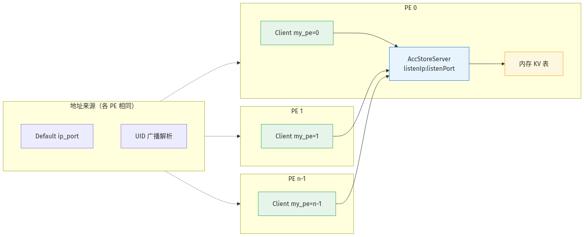
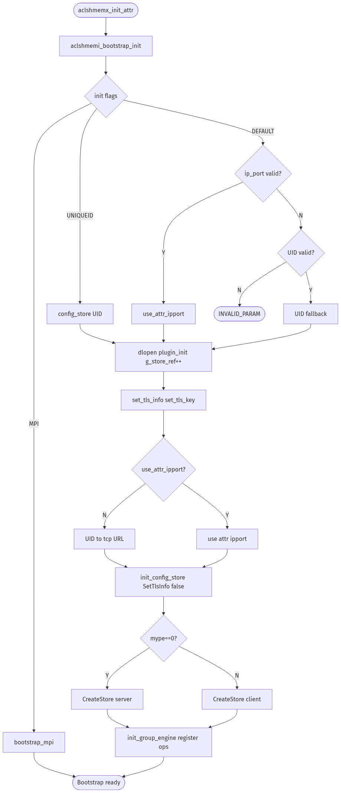
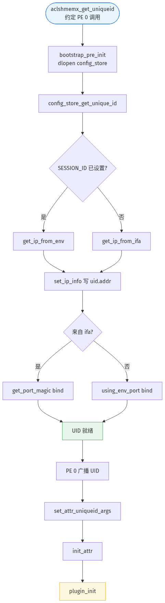
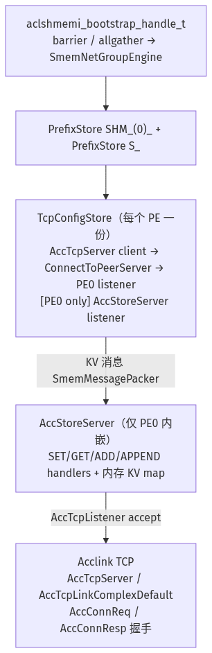
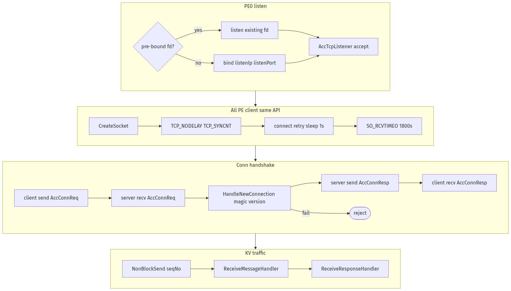
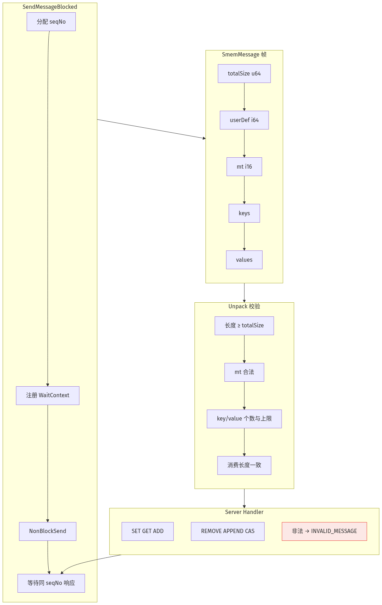
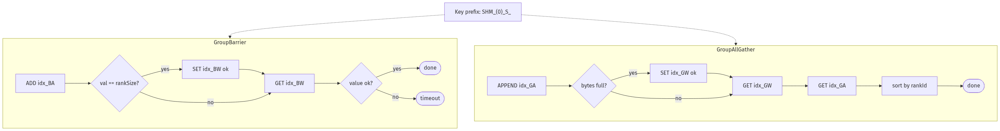

# Config Store Bootstrap in Detail

> This document describes the implementation of the **CPU-side control plane** Bootstrap in Default / UniqueID mode: TCP connection setup, the Config Store key-value protocol, and collective communication. It does not cover the NPU / HYBM symmetric heap. It complements Section 3.2 (Bootstrap overview) in [init_finalize.md](init_finalize.md).

**Suggested reading**: Read [Section 3.2 of init_finalize.md](init_finalize.md#32-parameters-and-bootstrap) first to learn about mode selection and timeout parameters. Starting from plugin loading, this document details the socket and message layers. **PE** in this document refers to a single process that participates in SHMEM (corresponding to `my_pe` / `n_pes`). Source code identifiers such as `rankId` and `mype` remain consistent with the code.

---

## Chapter 1: Overview

### 1.1 Topology

In Default / UID mode, the library loads `aclshmem_bootstrap_config_store.so` and forms a **star topology centered on PE 0**:

- **Each PE (including PE 0)**: Creates a `TcpConfigStore` client. Each client uses the **same API** `ConnectToPeerServer(serverIp_, serverPort_, ...)` to connect to the `serverIp:serverPort` parsed from `handle->ipport` (identical to the PE 0 listener address). `AccConnReq.rankId` is set to `my_pe`. For non-PE 0, the upper limit of connect retries comes from `shm_init_timeout`. The PE 0 client uses a fixed value of 60 (see Chapter 5 and Section 10.1).
- **Only PE 0 additionally starts a listener**: `AccStoreServer` accepts inbound TCP on `listenIp:listenPort` and maintains an in-memory KV table. The PE 0 client target address is **identical** to its listener address (usually the local machine IP plus port), rather than a separate connect method.

After Bootstrap completes, `SmemNetGroupEngine` implements `g_boot_handle.barrier` / `allgather` on the KV table. These operations support control plane synchronization in the init phase, such as `exchange_slice` and same-order `aclshmem_malloc`. They are unrelated to the subsequent HYBM device heap connection setup.



*Figure 1: PE 0 listens for the KV service. The clients of **each PE** connect to the same `serverIp:serverPort` (Default `ip_port` or UID broadcast).*

---

## Chapter 2: Entry Point and Call Chain

### 2.1 Overall Call Chain

```text
aclshmemx_init_attr()
  └─ aclshmemi_bootstrap_init()                    [shmemi_bootstrap.cpp]
       ├─ Select the plugin by flags and parse ip_port / UID
       ├─ dlopen("aclshmem_bootstrap_config_store.so")
       └─ aclshmemi_bootstrap_plugin_init()        [shmemi_bootstrap_config_store.cpp]
            ├─ [UID path] Build handle->ipport / sockFd / timeout from comm_args
            ├─ config_store_set_tls_info / set_tls_key (L316-322)
            ├─ init_config_store() → TcpConfigStore::Startup
            ├─ init_group_engine() → SmemNetGroupEngine
            └─ Register barrier / allgather / finalize
```

`aclshmemx_get_uniqueid` uses the **pre-init** path: `aclshmemi_bootstrap_pre_init` → `config_store_get_unique_id` (L45). **PE 0** generates the UID before the formal init.

### 2.2 Branches of `aclshmemi_bootstrap_init`

| Mode | Plugin | `comm_args` | IP/port source |
|------|------|-------------|-------------|
| `ACLSHMEMX_INIT_WITH_UNIQUEID` | config_store | Pointer to the UID structure | The plugin extracts it from the UID |
| `ACLSHMEMX_INIT_WITH_DEFAULT` | config_store | UID or nullptr | A valid `attr->ip_port` takes priority; otherwise, the UID is used as the fallback |
| `ACLSHMEMX_INIT_WITH_MPI` | bootstrap_mpi | `MPI_Comm*` | **Does not use the Config Store** |

Default branch (L280-304 in `shmemi_bootstrap.cpp`):

1. If `is_valid_ip_port_url(attr->ip_port)` is true, set `use_attr_ipport=true` and copy `ip_port`, `sockFd`, `shm_init_timeout`, and `control_operation_timeout`.
2. Otherwise, if `is_uid_args_valid(comm_args)` is true, use the UID fallback (`use_attr_ipport=false`).
3. Otherwise, return `ACLSHMEM_INVALID_PARAM`.

`is_valid_ip_port_url` requires the URL to be `tcp://host:port` or `tcp6://[host]:port`, the port to be **> 1024**, and the host to be a valid IP or hostname.



*Figure 2: Mode branches of `aclshmemi_bootstrap_init` → `plugin_init` (including TLS configuration) → `init_config_store` / `init_group_engine`. MPI mode does not enter the config_store path.*

---

## Chapter 3: IP and Port Parsing

### 3.1 Path A: `use_attr_ipport == true` (Default + valid ip_port)

| Field | Source | Purpose |
|------|------|------|
| `handle->ipport` | `attr->ip_port` | Parsed as the listening/connection address |
| `handle->sockFd` | `attr->option_attr.sockFd` | Pre-bound listen fd of PE 0 (-1 indicates that the library performs the bind) |
| `handle->timeOut` | `attr->option_attr.shm_init_timeout` | Connection setup on non-PE 0: maximum retry count of `ConnectToPeerServer` (see Section 10.1) |
| `handle->timeControlOut` | `attr->option_attr.control_operation_timeout` | Timeout of barrier/allgather (in seconds) |

Multiple instances: If `instance_id != 0`, `ip_port` is not empty, and the template port is **0**, `aclshmemi_instance_ctx_create` (`shmem_init.cpp`) calls `aclshmemi_instance_port_selection`. The function replaces the port based on `SHMEM_INSTANCE_PORT_RANGE`. Pure UID mode (empty `ip_port` and valid `comm_args`) skips this step.

### 3.2 Path B: UID / Default→UID (`use_attr_ipport == false`)

`plugin_init` (L280-314) reads `aclshmemi_bootstrap_uid_state_t` from `comm_args`:

- IPv4 → `tcp://{ip}:{port}`
- IPv6 → `tcp6://[{ip}]:{port}`
- `handle->sockFd = uid_args->inner_sockFd`
- `handle->timeOut = handle->timeControlOut = DEFAULT_TIMEOUT` (120). `timeControlOut` is the control plane timeout (in seconds). In the Config Store, `timeOut` is also used as the **connect retry count** (see Section 10.1)

After `handle->ipport` is written, the `serverIp_`/`serverPort_` values of **all PEs** point to the same address published by PE 0.

### 3.3 PE 0 Generates the UID (`config_store_get_unique_id`)

| Environment variable | Behavior |
|----------|------|
| `SHMEM_UID_SESSION_ID` | Parse the fixed `host:port` → `aclshmemi_using_env_port` binds this port and obtains `inner_sockFd` |
| (Not set) | `SHMEM_UID_SOCK_IFNAME` specifies the network interface card (NIC) (selected automatically if not set) → `aclshmemi_get_ip_from_ifa` obtains the IP → `aclshmemi_get_port_magic` randomly selects an available port in [1024,65536) and binds it, obtaining `inner_sockFd` |

`aclshmemi_set_ip_info` (`store_net_utils.h`) fills `addr` and `inner_sockFd` in `aclshmemx_uniqueid_t`. After PE 0 calls `aclshmemx_get_uniqueid`, PE 0 must **broadcast the complete UID bytes** to each PE. Each PE then calls `aclshmemx_set_attr_uniqueid_args`.



*Figure 6: The pre-init path of `aclshmemx_get_uniqueid`, IP/port binding, and the connection to the subsequent init. The library is not responsible for the UID broadcast.*

### 3.4 URL Parsing (Before the Store Is Built)

`init_config_store` calls `UrlExtraction::ExtractIpPortFromUrl` (`store_net_common.cpp`) to obtain the following from `handle->ipport`:

- `option.ip`: the listening/connection IP (the hostname is resolved and does **not** fall back to `0.0.0.0`)
- `option.port`: the port number (must be > 1024)

---

## Chapter 4: Layered Architecture



*Figure 7: Layers from `aclshmemi_bootstrap_handle_t` to Acclink TCP. KV collective communication is implemented through `PrefixStore` prefix keys, and PE 0 additionally embeds an `AccStoreServer` listener.*

| Component | File | Responsibility |
|------|------|------|
| `StoreFactory` | `store_factory.cpp` | `CreateStore` / `DestroyStore` / global TLS configuration |
| `TcpConfigStore` | `store_tcp_config.cpp` | Store client of each PE; PE 0 additionally embeds a Server |
| `AccStoreServer` | `store_tcp_config_server.cpp` | PE 0 KV service and message dispatch |
| `AccTcpServer` | `acc_tcp_server_default.cpp` | Transport layer (the name is confusing: both the client and the server use this class) |
| `AccTcpListener` | `acc_tcp_listener.cpp` | PE 0 accept and connection-level handshake |
| `SmemNetGroupEngine` | `store_net_group_engine.cpp` | KV-based barrier / allgather |

For the mapping between Figure 1 (topology) and the components in this figure, see the preceding table. PE 0 holds the listener and the client TCP paths at the same time, and its client uses the same `ConnectToPeerServer` entry as the other PEs.

---

## Chapter 5: Building the Store: `init_config_store`

```cpp
// shmemi_bootstrap_config_store.cpp:230-235
if (handle->mype == 0)
    CreateStore(ip, port, isServer=true, rankId=0, connMaxRetry=-1, sockFd);
else
    CreateStore(ip, port, isServer=false, rankId=mype, connMaxRetry=timeOut);
```

| Parameter | PE 0 (`my_pe==0`) | Non-PE 0 |
|------|-------------------|---------|
| `isServer` | `true` (embeds `AccStoreServer`) | `false` |
| `ConnectToPeerServer` | **Yes** (same API/target address as the other PEs) | **Yes** |
| `connMaxRetry` | `-1` → internally **60** | `handle->timeOut` |
| `connReq.rankId` | `0` | `mype` |
| `sockFd` | Pre-bound listen fd or -1 | Not used (-1 is passed) |

---

## Chapter 6: Socket Binding and Connection (Core)

### 6.1 PE 0: What the Listening Socket Binds

`AccStoreServer::AccServerStart` (`store_tcp_config_server.cpp:33-41`) sets the following:

```text
listenIp   = option.ip parsed from the URL
listenPort = option.port parsed from the URL
enableListener = true
sockFd     = handle->sockFd (pre-bound fd, or -1)
```

`AccTcpListener::Start` (`acc_tcp_listener.cpp:110`):

| Condition | Behavior |
|------|------|
| `listenFd_ > 0` (pre-bound) | **Skips bind** and calls `listen(backlog=200)` on the existing fd |
| `listenFd_ <= 0` | `socket` → `SO_REUSEADDR` → `bind(listenIp, listenPort)` → `listen(200)` |

Sources of the pre-bound fd:

- Default: `attr->option_attr.sockFd` (the listening socket already bound by the user)
- UID: the `inner_sockFd` generated when PE 0 runs `get_uniqueid` (produced by `aclshmemi_get_port_magic` or `aclshmemi_using_env_port`)

The listening address is the **specific IP/hostname** in the URL. The library does not automatically bind `INADDR_ANY`.

### 6.2 Client connect on Each PE (Unified Path)

`TcpConfigStore::Startup` (`store_tcp_config.cpp:152-203`) performs the same client connection setup on **all PEs** (PE 0 also calls it after `AccStoreServer::Startup`):

```text
ConnectToPeerServer(serverIp_, serverPort_, connReq, retryMaxTimes, accClientLink_)
connReq.rankId = rankId_   // 0 for PE 0, mype for the others
```

- `serverIp_` / `serverPort_`: The values are the same on all PEs. They are parsed from `handle->ipport` and match the PE 0 `listenIp:listenPort`.
- The PE 0 client connects to the **same** `serverIp:serverPort` (usually the local listener address). Non-PE 0 connects to the address published by the UID broadcast or by PE 0 in Default mode. The connect implementation and parameter structure are **identical**; only `rankId` and `retryMaxTimes` differ.

`ConnectToPeerServer` (`acc_tcp_server_default.cpp:532`):

1. Calls `CreateSocket(peerIp)` → resolves IPv4/IPv6/hostname.
2. Sets `TCP_NODELAY` and `TCP_SYNCNT=1` (fast connect probing).
3. Calls `connect()` in a loop. On failure, it calls **`sleep(1)`**, with at most `maxRetryTimes` attempts.
4. On success, it sets `SO_RCVTIMEO = ACC_LINK_RECV_TIMEOUT` (1800s) and enters `Handshake`.

### 6.3 Two Socket Paths After the Connection Is Established

**Path 1 — Service KV (all PEs)**

```text
TcpConfigStore::SendMessageBlocked
  → accClientLink_->NonBlockSend(seqNo, SmemMessage body)
  → PE 0 AccStoreServer::ReceiveMessageHandler
  → SET/GET/ADD/... Handler
  → the response wakes the client through ReceiveResponseHandler
```

**Path 2 — Connection-level handshake when a new PE joins (listener accept)**

```text
AccTcpListener accepts the new TCP fd
  → ProcessNewConnection: recv(AccConnReq)
  → (Optional) TLS accept
  → HandleNewConnection: verify magic/version → Initialize link → newLinkHandle_ (AccStoreServer is LinkConnectedHandler, logging only)
  → Add the link to the worker epoll
  → send(AccConnResp{result=0})
```

Note: KV service traffic uses the **established accClientLink_**. The `AccConnReq` on the accept thread registers the new inbound connection inside Acclink and is unrelated to the Config Store message frames.



*Figure 3: PE 0 listens; the clients of **each PE** set up connections through the same connect API; the connection-level handshake is shown separately for the client and the server; the KV service is independent of this.*

---

## Chapter 7: Acclink TCP Handshake

The connection-level handshake completes on `AccConnReq` / `AccConnResp`. When the Config Store sets up a connection, the request carries `rankId` (that is, `my_pe`, `store_tcp_config.cpp:201-202`).

### 7.1 Client (Active connect Side, `Handshake`)

1. Sends the entire structure with `send(AccConnReq)`.
2. (Optional) TLS: `CreateSSLLink`.
3. Calls `BlockRecv(AccConnResp)` and requires `result == ACC_OK`.

### 7.2 Server (accept Side, `ProcessNewConnection` → `HandleNewConnection`)

1. `AccTcpListener::ProcessNewConnection` (`acc_tcp_listener.cpp:300`) calls `recv(AccConnReq)`. The length must equal `sizeof(AccConnReq)`; otherwise, the fd is closed.
2. (Optional) TLS: `AccTcpSslHelper::NewSslLink`.
3. Calls `HandleNewConnection` (`acc_tcp_server_default.cpp:361`):
   - **magic / version verification** (L364-372): rejects the connection on mismatch;
   - Initializes the link with `Initialize` and calls `newLinkHandle_` (registered on the Config Store as `AccStoreServer::LinkConnectedHandler`, L170-174, logging only);
   - Calls `EnableNoBlocking`, and `worker->AddLink` adds the link to epoll.
4. `ProcessNewConnection` sends `AccConnResp{result=0}` (L345-347).

---

## Chapter 8: Config Store Message Protocol

### 8.1 Frame Format (`SmemMessagePacker`)

**On-wire layout** (`store_message_packer.cpp:18-47`):

```text
[totalSize: u64]
[userDef:   i64]     ← GET blocking wait timeout (ms); usually 0 for other operations
[mt:        i16]     ← MessageType
[keyCount:  u64]
  repeated keyCount times: [keyLen: u64][key bytes]
[valueCount: u64]
  repeated valueCount times: [valueLen: u64][value bytes]
```

**Unpack validation** (L69-119):

- The buffer length must satisfy `Full()` (≥ header and ≥ totalSize).
- `mt` must satisfy `SET ≤ mt ≤ INVALID_MSG` (`store_message_packer.cpp:83`; the valid service types are `SET` through `CAS`).
- `keyCount ≤ 10`, and each key is `≤ 2048` bytes (server); the key limit on the client is 1024.
- `valueCount ≤ 10`, and each value is `≤ 64MB`.
- After parsing, `totalSize` must equal the actually consumed length; otherwise, parsing fails.

### 8.2 Message Types and Semantics

| Type | Client request | Server validation and behavior |
|------|-------------|-------------------|
| **SET** | 1 key + 1 value | Writes or overwrites the KV; wakes up GET waiters on the key if any |
| **GET** | 1 key, no value; `userDef`=timeout in ms | Returns the value immediately if it exists; otherwise blocks until a SET arrives or the timeout expires (timer thread) |
| **ADD** | 1 key + increment (decimal string) | Adds atomically; creates the key if it does not exist |
| **REMOVE** | 1 key | Deletes the key; returns `NOT_EXIST` if the key does not exist |
| **APPEND** | 1 key + byte block | Appends the data; returns the new total length |
| **CAS** | 1 key + expect + new | Performs compare-and-swap |

Invalid types, key/value counts, or lengths → `INVALID_MESSAGE` (-400) or `INVALID_KEY` (-401).

### 8.3 Client Sending and Response Matching

`TcpConfigStore::SendMessageBlocked` (L484-512):

1. Allocates a monotonically increasing `seqNo`.
2. Registers `ClientWaitContext` in `msgClientContext_[seqNo]`.
3. Calls `accClientLink_->NonBlockSend(0, seqNo, dataBuf, nullptr)`.
4. Blocks waiting for `ReceiveResponseHandler` to wake it up with the **same seqNo**, and returns `AccTcpRequestContext`.
5. The caller (such as `Set`/`Get`) calls `Unpack` on the response body and reads `Header().result` and the payload.

When the link breaks, `LinkBrokenHandler` wakes up all pending requests and marks them as failed.



*Figure 4: The `SmemMessagePacker` on-wire layout, the Unpack boundary validation, and the flow of matching client responses by `seqNo`.*

---

## Chapter 9. SmemNetGroupEngine: barrier and allgather

### 9.1 Key name prefixes

```text
init_group_engine:
  PrefixStore(store, "SHM_(0)_")        // DEFAULT_ID = 0

SmemNetGroupEngine::Create:
  PrefixStore(store, "S_")               // Static group (bootstrap: option.dynamic=false)

// When option.dynamic=true, the "D_" prefix is used (dynamic group Join/Leave, not the Bootstrap path)
```

Complete key example: `SHM_(0)_S_{groupVersion}_{sn}_BA`.

### 9.2 GroupBarrier (`store_net_group_engine.cpp:80`)

For the sequence number `idx = "{groupVersion}_{barrierGroupSn_}"`:

1. `ADD idx_BA` → the return value `val` (the current number of arrived PEs).
2. If `val == rankSize` (`n_pes`), the last arriving PE executes `SET idx_BW = "ok"`.
3. All PEs execute `GET idx_BW` with the timeout `option_.timeoutMs` (from `control_operation_timeout * 1000`).
4. The read value must equal `"ok"`.
5. When `val == 1` and `barrierGroupSn_ > REMOVE_INTERVAL` (2), the first arriving PE periodically executes `REMOVE` on the `{idx}_BA` / `{idx}_BW` keys from two rounds earlier.

When `npes == 1`, the bootstrap barrier returns directly (`config_store_bootstrap_barrier` L191-194).

### 9.3 GroupAllGather (starting from L207)

1. Construct `{my_pe: u32}{payload}` (the on-wire field name is `rankId`), execute **APPEND** on `idx_GA`, and return the cumulative byte count `val`.
2. When `val == sendSize * rankSize`, the last arriving PE executes `SET idx_GW = "ok"`.
3. All PEs execute `GET idx_GW` to wait for completion, then execute `GET idx_GA` to fetch the full blob.
4. Sort by the embedded `rankId` (PE number) and copy to `recvBuf` (one `sendSize` segment per PE).
5. When `val == input.size()` and `allGatherGroupSn_ > REMOVE_INTERVAL` (2), the **first** PE to finish **APPEND** cleans up the `{idx}_GA` / `{idx}_GW` keys from two rounds earlier (`store_net_group_engine.cpp:231`).

Bootstrap wrapper: `config_store_bootstrap_allgather` requires the `recv` buffer to be ≥ `len * npes`.



*Figure 5: Key prefix `SHM_(0)_S_`; the barrier (ADD/SET/GET) and allgather (APPEND/SET/GET/sorting) protocols implemented by `SmemNetGroupEngine` on the KV store.*

---

## Chapter 10. Timeouts, TLS, and multiple instances

### 10.1 Timeout summary

**`shm_init_timeout` naming and implementation**

The external field name and the `DEFAULT_TIMEOUT` comment in `shmem_host_def.h` both describe **an init timeout in seconds**. On the Config Store connection setup path, this value **does not undergo a seconds→count conversion** and is passed through as is:

```text
option_attr.shm_init_timeout
  → g_boot_handle.timeOut                    [shmemi_bootstrap.cpp:289]
  → CreateStore(..., connMaxRetry)           [shmemi_bootstrap_config_store.cpp:234]
  → TcpConfigStore::Startup(reconnectRetryTimes)
  → ConnectToPeerServer(..., maxRetryTimes)  [acc_tcp_server_default.cpp:556]
```

`ConnectToPeerServer` calls `connect()` inside the `timesRetried < maxRetryTimes` loop and retries after `sleep(1)` on failure. Therefore, the value **N means at most N connect attempts**. In the worst case, the connection setup window is about **N seconds** (the default 120 is numerically close to "a 120-second timeout"). However, the implementation is **an upper limit on retry counts**, not a wall-clock timer.

| Configuration | Typical value | Purpose | Implementation semantics |
|------|--------|------|----------|
| `shm_init_timeout` | 120 by default (the API is named in seconds) | Non-PE 0 connecting to the PE 0 listener | **Retry count** → `maxRetryTimes` |
| PE 0 client connection | Fixed 60 times | Same API, connecting to the local `serverIp:serverPort` | `connMaxRetry=-1` → `CONNECT_RETRY_MAX_TIMES` |
| `control_operation_timeout` | User attr (seconds) | barrier/allgather | `SmemGroupOption.timeoutMs = ×1000` |
| UID path `timeOut` | `DEFAULT_TIMEOUT` (120) | Non-PE 0 connection setup | **Retry count** (semantically different from `timeControlOut`, which is in seconds) |
| `ACC_LINK_RECV_TIMEOUT` | 1800s | Socket `SO_RCVTIMEO` after the handshake completes | Seconds |
| GET blocking | `userDef` ms in the request | Upper limit for the Server side to wait for a key to appear | Milliseconds |

### 10.2 TLS

- Before init: `aclshmemx_set_conf_store_tls` / `aclshmemx_set_config_store_tls_key` write to `g_boot_handle` (`shmem_init.cpp:681` / `696`).
- **Before** calling `init_config_store`, `plugin_init` calls `config_store_set_tls_info` and `config_store_bootstrap_set_tls_key` based on the handle (`shmemi_bootstrap_config_store.cpp:316-322`) to write into `StoreFactory`.
- At the entry of `init_config_store`, `SetTlsInfo(false, nullptr, 0)` runs immediately (L225) and sets `StoreFactory::enableTls` to false; `CreateStore` → `InitTlsOption` (`store_factory.cpp:210-217`) initializes `tlsOption_` based on the current `enableTls` and the cached TLS fields.
- When TLS is enabled, the listener and the client load the OpenSSL dynamic library and call `Start` (`AccTcpSslHelper`) based on `tlsOption.enableTls` in `AccStoreServer::AccServerStart` / `TcpConfigStore::AccClientStart`.

### 10.3 Multiple instances: `g_store_ref`

- On each `plugin_init`, `g_store_ref++` runs (L263).
- `config_store_bootstrap_finalize`: `g_store_ref--`; only when the count drops to 0 is `StoreFactory::DestroyStore()` called (the TLS cleanup thread).
- Each instance has independent `ConfigStoreState` and `TcpConfigStore`; the global Destroy does not stop connections of other instances.

---

## Chapter 11. Finalize

### 11.1 Call location and control barrier

Within `aclshmemi_finalize_impl`, each PE calls **`aclshmemi_control_barrier_all()`** after the symmetric heap / entity / **default stream** releases complete and **before** `aclshmemi_bootstrap_finalize()`. This call performs a **`GroupBarrier`** on the Config Store (the same path as the init wrap-up and post-malloc barriers: `g_boot_handle.barrier` → `config_store_bootstrap_barrier` → KV `ADD/GET`).

**Semantics**: all `n_pes` PEs must **have entered finalize and reached this barrier** before any PE is allowed to perform Bootstrap teardown. PE 0 **will not** close the listener while some PEs have not reached the barrier.

```text
aclshmemi_finalize_impl()
  ├─ team / signal / memory_manager / heap / entity / stream …
  ├─ aclshmemi_control_barrier_all()     ← Finalize control-plane synchronization (Config Store GroupBarrier)
  └─ aclshmemi_bootstrap_finalize()
       └─ config_store_bootstrap_finalize()
            ├─ g_store_ref--
            ├─ [g_store_ref==0] StoreFactory::DestroyStore()   // only the TLS cleanup thread
            ├─ group_engine_ = nullptr
            ├─ store_ = nullptr  → ~TcpConfigStore → Shutdown()
            └─ delete ConfigStoreState
```

| Phase | Cross-PE synchronization | Description |
|------|------------|------|
| heap / stream release | No | Each PE executes locally in sequence |
| **`aclshmemi_control_barrier_all`** | **Yes** | Config Store KV barrier; for the timeout, see `control_operation_timeout` |
| After `aclshmemi_bootstrap_finalize` | No | Each PE tears down its Bootstrap connection locally |

When `npes == 1`, the bootstrap barrier is skipped directly (the same as in the init phase). For the finalize flow chart, refer to [init_finalize.md §4.2](init_finalize.md#42-execution-order) and `images/initialization/shmem_finalize_flow.png`.

### 11.2 Local PE resource release (`TcpConfigStore::Shutdown`)

After the barrier **passes**, each PE enters `config_store_bootstrap_finalize` → `~TcpConfigStore` → `Shutdown()`:

**All PEs** (`store_tcp_config.cpp:213-230`):

1. `accClientLink_ = nullptr`
2. `accClient_->Stop()` — disconnects the client TCP from this PE to PE 0

    **Only PE 0 additionally** (`accServer_ != nullptr`), **immediately** after the client stops (`store_tcp_config.cpp:226-228`):

3. `AccStoreServer::Shutdown` → `accTcpServer_->Stop()` (`acc_tcp_server_default.cpp:109`):

   - **First** `StopAndCleanListener` (L117) → join the accept thread → `SafeCloseFd(listenFd_)`
   - **Then** `StopAndCleanWorkers` (L119) — tears down inbound TCP connections that are still connected
   - **Then** `StopAndCleanDelayCleanup` (L121)
4. Join the GET timeout `timerThread_` (`store_tcp_config_server.cpp:130-136`)
5. `sockFd_ = -1`

The order within the local `Shutdown` on PE 0 (consistent with `AccTcpServerDefault::Stop`):

```text
① Close PE 0's own client (accClient_->Stop)
② AccStoreServer::Shutdown → close the listener → close the server worker → delay cleanup
③ join timerThread_
```

Because the barrier already guarantees that **all PEs have reached the synchronization point before finalize tears down Bootstrap**, the situation "other PEs have not entered finalize while PE 0 has closed the listener" cannot occur. If some PE **never enters finalize**, the other PEs block at the barrier in §11.1 until the timeout and **will not** execute `aclshmemi_bootstrap_finalize`.

### 11.3 Whether "all PEs release" can be guaranteed

| Dimension | Behavior |
|------|------|
| **PEs that have entered finalize** | Each performs `Shutdown` after the barrier passes; PE 0 closes the listener and each PE closes its client |
| **PEs that have not entered finalize** | PEs already in finalize wait at the `GroupBarrier`; after the timeout, finalize **fails** and Bootstrap is **not torn down** (if the barrier fails, `aclshmemi_bootstrap_finalize` should not be reached) |
| **Symmetry requirement** | **Every PE must still call** `aclshmem_finalize`; the barrier only synchronizes "the set of PEs that have entered finalize" and does not replace the application layer starting finalize |
| **Multiple instances** | Each instance has an independent `ConfigStoreState`; when `g_store_ref` drops to 0, `DestroyStore()` performs only the global TLS cleanup |

**Conclusion**: the finalize phase has a control barrier **before** Bootstrap teardown; the PE 0 listening port is released when **the barrier passes and the local PE executes `Shutdown`**.

### 11.4 Scenarios not covered by the barrier

The finalize barrier **only** guarantees that all PEs that have entered finalize align before Bootstrap teardown (§11.1). The application must still guarantee the following:

**(1) Device work in flight**

`aclshmemi_control_barrier_all` is a **CPU control-plane** KV synchronization and **does not wait** for device kernels or streams. The heap, entity, and so on are released locally **before** the barrier. If the device still has unfinished RMA operations, they will access already released resources during finalize. Therefore, stream / kernel synchronization must complete **before** calling `aclshmem_finalize` (consistent with [init_finalize.md §1.5](init_finalize.md#15-finalization-constraints)).

**(2) Symmetric calls and barrier rounds**

Before each return, `aclshmem_malloc` / `aclshmem_free` performs a round of the Config Store `GroupBarrier` through `aclshmemi_control_barrier_all` (§9.2, with `barrierGroupSn_` incremented). Finalize calls one more barrier on the same path **before** `aclshmemi_bootstrap_finalize`. Each PE must participate in malloc/free with the **same order and the same sizes** and call `aclshmem_finalize` **symmetrically**.

If runtime malloc/free participation is not symmetric, PEs stop at control barriers of **different rounds** (for example, some PEs wait at the `{sn}_BA` triggered by malloc while the other PEs have advanced to later sequence numbers). If some PE enters finalize first, it waits at the barrier of **the finalize round** for all PEs to arrive. PEs that have not entered finalize or are still stuck at an earlier malloc barrier **will not join the same round**. The symptoms are:

- PEs that have entered finalize: **stuck at the control barrier before `aclshmemi_bootstrap_finalize`**;
- PEs still on the malloc/free path: **stuck at the control barrier corresponding to that allocation/free**;

The two sides have **mismatched barrier rounds** and cannot wait for each other. The finalize side fails at `control_operation_timeout` and **will not** execute `aclshmemi_bootstrap_finalize`. Symmetric finalize itself follows the same mechanism: if any PE does not enter finalize, the other PEs likewise cannot all arrive at the same barrier round.

| Scenario | Consequence |
|------|------|
| malloc/free is not symmetric and some PEs finalize first | The finalize side and the malloc side have **mismatched barrier rounds** → they are stuck at different barrier rounds → finalize times out and `bootstrap_finalize` is **not** executed |
| Some PE does **not** call `aclshmem_finalize` | PEs that have entered finalize are stuck at the pre-finalize barrier → timeout → same as above |
| All PEs align malloc/free and finalize symmetrically | The finalize barrier gathers all PEs → each PE executes `aclshmemi_bootstrap_finalize` |
| The device is synced | Avoids in-flight RMAs after the heap is released (§11.4 (1)) |

**Recommendation**: complete device synchronization → each PE calls `aclshmem_finalize` **symmetrically** → after the in-library barrier aligns, tear down the Config Store.

---

## Chapter 12. End-to-end sequence of PE 0 and non-PE 0

### Common part (all PEs)

1. Parse the **same** `ipport` (Default attr, UID broadcast, or fallback).
2. `TcpConfigStore::Startup` → `ConnectToPeerServer(serverIp_, serverPort_, rankId=mype, …)` → handshake → `accClientLink_`.
3. `init_group_engine` → participate in barrier/allgather.

### Additional steps for PE 0 only

1. `CreateStore(isServer=true)` → `AccStoreServer::Startup`: `bind/listen` on `listenIp:listenPort` (this can complete **before** the client connects, making the listener ready).
2. The client connects to the **same** `serverIp:serverPort` as the listener; `connMaxRetry` is fixed at 60 and is unrelated to `shm_init_timeout`.
3. Optionally pre-bind a `sockFd` for the listener to reuse.

### Non-PE 0

1. `CreateStore(isServer=false)`, with no listener.
2. The target address of `ConnectToPeerServer` is **the same as** that of the PE 0 client; `connMaxRetry = timeOut` (from `shm_init_timeout` or the UID `DEFAULT_TIMEOUT`).

### Finalize (corresponding to §11)

1. Local resource release (team / heap / entity / stream).
2. **`aclshmemi_control_barrier_all`** — all PEs align on the Config Store.
3. **`aclshmemi_bootstrap_finalize`** → each PE runs `TcpConfigStore::Shutdown`; PE 0 additionally closes the listener.

| PE | Released after the barrier passes |
|----|-------------------|
| All PEs | Client `accClientLink_`, `accClient_->Stop()` |
| PE 0 additionally | `listenFd_` closure, accept/timer threads, and the server worker |

---

## Chapter 13. Source code index

| Topic | Path | Key symbols |
|------|------|----------|
| Bootstrap branch | `src/host/init/bootstrap/shmemi_bootstrap.cpp` | `aclshmemi_bootstrap_init` L262, `is_valid_ip_port_url` L195 |
| Plugin entry | `src/host/bootstrap/shmemi_bootstrap_config_store.cpp` | `plugin_init` L260, `init_config_store` L214, `config_store_bootstrap_barrier` L177 |
| UID generation | Same as above | `config_store_get_unique_id` L45 |
| IP/port utilities | `src/host/bootstrap/config_store/store_net_utils.h` | `aclshmemi_set_ip_info`, `aclshmemi_get_port_magic` |
| Store client | `src/host/bootstrap/config_store/store_tcp_config.cpp` | `Startup` L152, `SendMessageBlocked` L484 |
| KV server | `src/host/bootstrap/config_store/store_tcp_config_server.cpp` | `ReceiveMessageHandler` L143, handlers L183+ |
| Message encoding and decoding | `src/host/bootstrap/config_store/store_message_packer.cpp` | `Pack`/`Unpack` |
| Collective communication | `src/host/bootstrap/config_store/store_net_group_engine.cpp` | `GroupBarrier` L80, `GroupAllGather` L207 |
| TCP connection | `src/host/bootstrap/config_store/acc_links/csrc/acc_tcp_server_default.cpp` | `ConnectToPeerServer` L532, `Handshake` L675 |
| Listener accept | `src/host/bootstrap/config_store/acc_links/csrc/acc_tcp_listener.cpp` | `Start` L110, `ProcessNewConnection` L300 |
| Handshake structures | `src/host/bootstrap/config_store/acc_links/include/acc_def.h` | `AccConnReq`, `AccConnResp` |

---

## Chapter 14. Implementation notes

1. **All PEs use the same client connection setup API**; PE 0 additionally holds the listener. The `connMaxRetry` of the PE 0 client is fixed at 60, and non-PE 0 uses the limit passed in through `shm_init_timeout`.
2. **`AccTcpServer` is the name of the transport engine**; every PE has a client instance. The listener is held only by the `AccStoreServer` of PE 0.
3. The **connection-level handshake** verifies on the accept path whether `AccConnReq.magic` / `AccConnReq.version` match `AccTcpServerOptions`; mismatches are rejected (corresponding to the "Check Magic" step in `connection_between_ranks.png` in [init_finalize.md](init_finalize.md)).
4. **UID generation** depends on the env/ifa port binding logic; `magic` is written at UID generation time and must be byte-level identical across all PEs.
5. **hostname listening/connection** must resolve to a concrete address; it will not automatically listen on all NICs.
