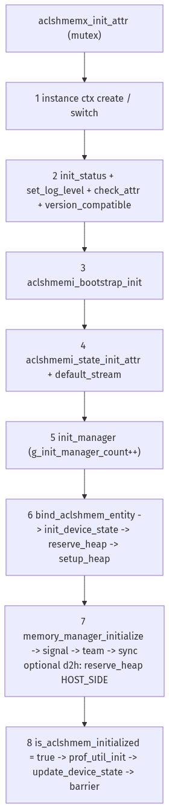
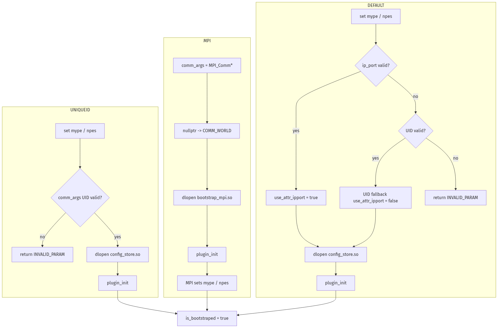
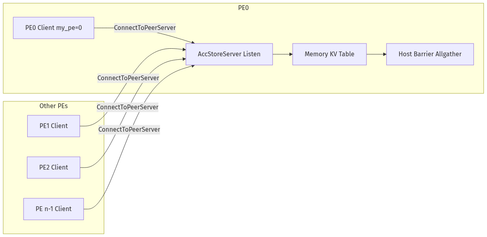
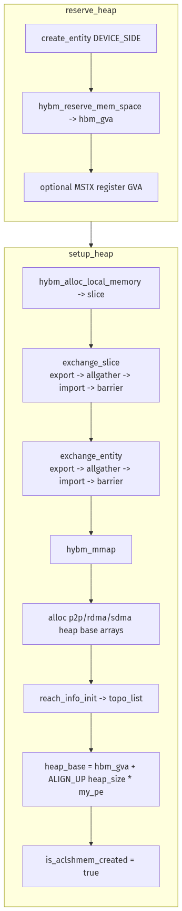
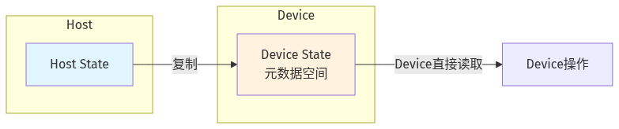
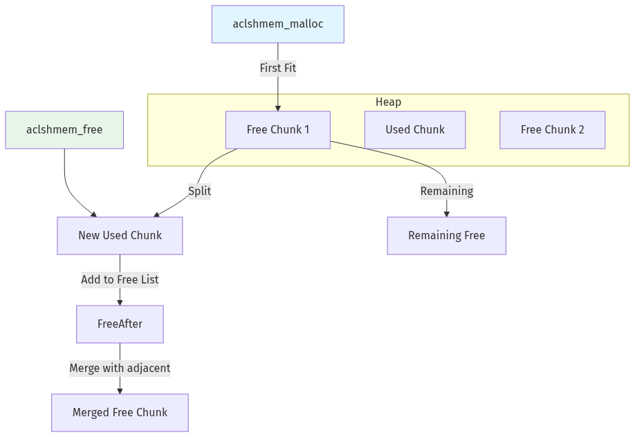
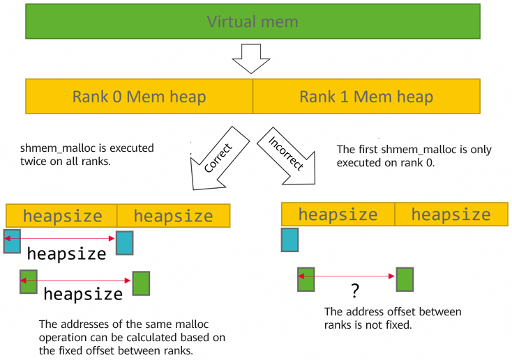
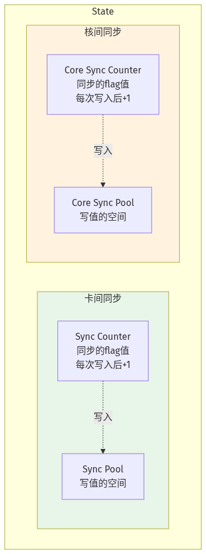
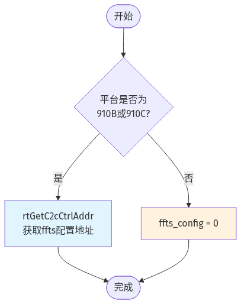
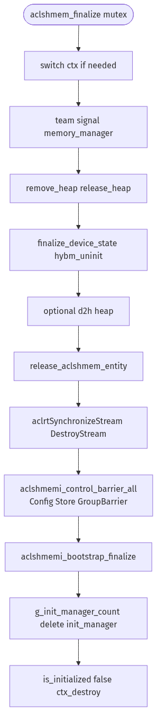

# SHMEM Initialization and Finalization Flow

> This document describes the flow, parameters, and source code implementation of SHMEM initialization and finalization. Except for the external interfaces listed below, all other functions are internal implementations, and users should not call them directly.

**Reading guide**: To get a quick overview, read Chapter 1 and Chapter 2. For implementation details, read Chapter 3 and Chapter 4 and refer to `src/host/init/shmem_init.cpp`. For the Default/UID **Config Store control plane** (TCP connection establishment, KV protocol, and socket binding), refer to [config_store_bootstrap.md](config_store_bootstrap.md). To locate functions, see Chapter 5. For troubleshooting, see Chapter 6.

---

## 1. Overview

### 1.1 Flow Summary

Each PE calls `aclshmemx_init_attr` symmetrically to complete initialization, and calls `aclshmem_finalize` / `aclshmemx_finalize` symmetrically to complete finalization. The following requirements must be met: ① Every PE participates in init/finalize; ② except for `my_pe`, the init parameters are identical; ③ all ranks call `aclshmem_malloc` / `aclshmem_free` in the same order with the same sizes.

Initialization completes the following steps in sequence:

1. **Bootstrap (control plane, CPU)**: Establishes connections between ranks (Config Store/TCP or MPI), and exchanges heap establishment metadata and synchronizes progress through the internal `barrier` / `allgather`.
2. **HYBM heap establishment (data plane, NPU)**: `reserve_heap` reserves GVA addresses, and `setup_heap` allocates memory, exchanges slices/entities, and performs `mmap`. Afterwards, `malloc` calls in the same order with the same sizes produce identical heap offsets, enabling RMA operations such as `aclshmem_putmem` / `aclshmem_getmem`.
3. **Submodules ready**: The heap allocator, team, signal, platform synchronization, and other submodules finish initialization, and the application can call SHMEM APIs.

Finalization releases resources in the reverse order: submodules → remove/release the symmetric heap → `finalize_device_state` → `release_aclshmem_entity` → ACL streams → **`aclshmemi_control_barrier_all` (control-plane collective synchronization)** → Bootstrap → `init_manager`.

The internal `barrier` of Bootstrap serves the init/finalize control flow and differs from the runtime `aclshmem_barrier` (team-level service synchronization). With multiple instances, `init_manager`, HYBM global initialization, and the Config Store are shared through reference counting and are released after the last instance is finalized.

### 1.2 Key Concepts

| Concept | Description |
|------|------|
| **PE / rank** | A process participating in SHMEM; `my_pe` is the ID of the current PE (starting from 0), and `n_pes` is the total number of PEs. |
| **Symmetric heap** | Each PE owns a heap of equal length; `malloc` calls in the same order with the same sizes produce identical heap offsets. |
| **Bootstrap** | The host-side communication layer in the init stage, used to establish connections, exchange metadata, and ensure a consistent `malloc` order. |
| **HYBM** | The underlying hybrid memory library; **entity** is a memory domain handle, **slice** is physical memory, and **GVA** is a reserved virtual address. |
| **instance** | Multiple sets of SHMEM contexts in the same process (`instance_id`, default 0). |
| **host / device state** | The host maintains `g_state`; operators read the device copy synchronized to the NPU metadata area. |

### 1.3 Typical Usage

**UID mode** (no MPI and no `ip_port` set):

```bash
rank 0: aclshmemx_get_uniqueid(&uid)          // rank 0 generates the UID by convention, see examples/init
rank 0: broadcast the uid                     // the library does not handle broadcasting
all ranks: aclshmemx_set_attr_uniqueid_args(my_pe, n_pes, heap_size, &uid, &attr)
all ranks: aclshmemx_init_attr(ACLSHMEMX_INIT_WITH_UNIQUEID, &attr)
all ranks: aclshmem_finalize()
```

**MPI mode**: Call `aclshmemx_init_attr(ACLSHMEMX_INIT_WITH_MPI, &attr)`; `comm_args` is of type `MPI_Comm*` (`nullptr` means `MPI_COMM_WORLD`). The `my_pe` / `n_pes` values in `attr` must match `MPI_Comm_rank` / `MPI_Comm_size` (they are written to `g_state` and the Bootstrap handle respectively; inconsistencies cause abnormal behavior afterwards).

**Default mode** (the rank 0 address is known):

```bash
all ranks: attr.ip_port = "tcp://rank0_host:port", and fill in my_pe / n_pes / local_mem_size
all ranks: aclshmemx_init_attr(ACLSHMEMX_INIT_WITH_DEFAULT, &attr)
all ranks: aclshmem_finalize()
```

For complete samples, see `examples/init`. For multiple instances, see [multi_instance.md](multi_instance.md).

### 1.4 Initialization States

| `aclshmemx_init_status()` | Meaning |
|---------------------------|------|
| `ACLSHMEM_STATUS_NOT_INITIALIZED` | `is_aclshmem_created == false` |
| `ACLSHMEM_STATUS_SHM_CREATED` | The heap is created and submodules are being initialized (intermediate state) |
| `ACLSHMEM_STATUS_IS_INITIALIZED` | `aclshmem_malloc`, RMA operations, teams, and other APIs are available |

The same `instance_id` cannot be initialized repeatedly: after `setup_heap` sets `is_aclshmem_created = true`, you must not call `aclshmemx_init_attr` again.

### 1.5 Finalization Constraints

1. Every PE must finalize.
2. Wait for device kernels / streams to complete before finalize; every PE must enter finalize symmetrically, so that all PEs align on the Config Store through `aclshmemi_control_barrier_all` before Bootstrap is dismantled (see Section 4.2).
3. Do not call SHMEM APIs after finalize.

---

## 2. External Interface Overview

### Initialization

| Interface | Description |
|------|------|
| `aclshmemx_get_uniqueid` | By convention, rank 0 calls it; generates a UID (containing `addr` and `magic`). |
| `aclshmemx_set_attr_uniqueid_args` | `(my_pe, n_pes, local_mem_size, uid, attr)`. |
| `aclshmemx_init_attr` | The main entry point; all PEs call it symmetrically. |
| `aclshmemx_init_status` | Queries the initialization stage. |
| `aclshmemx_instance_ctx_get` / `set` | Obtains/switches contexts among multiple instances. |
| `aclshmem_info_get_version` / `get_name` | The library version and name. |

### Finalization

| Interface | Description |
|------|------|
| `aclshmem_finalize` | Finalizes the currently active instance. |
| `aclshmemx_finalize` | Finalizes by `instance_id`. |

### In-Operator Helpers

| Interface | Description |
|------|------|
| `util_get_ffts_config` / `util_set_ffts_config` | The FFTS base address inside A2/A3 operators; calling it is optional on the 950 (Section 3.3.7.4). |

### Optional Configuration Before Initialization

| Interface | Description |
|------|------|
| `aclshmemx_set_config_store_tls_key` / `aclshmemx_set_conf_store_tls` | Config Store TLS configuration. |

---

## 3. Initialization in Detail

### 3.1 Overview

The entry point is `aclshmemx_init_attr` (`shmem_init.cpp`, protected by a mutex). The following figure and table correspond to the steps in Section 3.3; see Section 3.2 (parameters) and Section 3.3 (step-by-step description) for more information.



| Step | Source Code Call | File |
|------|----------|------|
| 1 Multiple instances | `aclshmemi_instance_ctx_create` → `aclshmemx_instance_ctx_set_impl` | `shmem_init.cpp` |
| 2 Validation | `aclshmemx_init_status` (must be `NOT_INITIALIZED`) → `set_log_level` → `check_attr` → `decode_runtime_config` + `apply_runtime_config` | `shmem_init.cpp` |
| 3 Bootstrap | `aclshmemi_bootstrap_init` | `shmemi_bootstrap.cpp` |
| 4 State | `aclshmemi_state_init_attr` | `shmem_init.cpp` |
| 5 Backend | `new aclshmemi_init_backend()` (`g_init_manager_count++`) | `shmem_init.cpp` |
| 6 Heap | `bind_aclshmem_entity` → `init_device_state` → `reserve_heap` → `setup_heap` | `shmem_init_backend.cpp` |
| 7 Submodules | `memory_manager_initialize` → (optional `reserve_heap(HOST)`) → `aclshmemi_signal_init` → `aclshmemi_team_init` → `aclshmemi_sync_init` | `shmem_init.cpp` and so on |
| 8 Final steps | `is_aclshmem_initialized = true` → `prof_util_init` → `update_device_state` → `aclshmemi_control_barrier_all` | `shmem_init.cpp` |

At the end of `setup_heap`, `is_aclshmem_created` is set to `true`; at the beginning of step 8, `is_aclshmem_initialized` is set to `true`. If the first creation with `instance_id != 0` fails, the scope guard calls `aclshmemi_instance_ctx_destroy(id)`. The state must be `ACLSHMEM_STATUS_NOT_INITIALIZED` when entering init.

### 3.2 Parameters and Bootstrap

Each PE fills in `my_pe`, `n_pes`, and `local_mem_size` in `aclshmemx_init_attr_t` and selects a Bootstrap mode. The library actually maps `local_mem_size + ACLSHMEM_EXTRA_SIZE` (`g_state.heap_size`).

**Bootstrap modes**

| Mode | Preparation |
|------|--------|
| `ACLSHMEMX_INIT_WITH_DEFAULT` | A valid `ip_port`, or fall back to UID |
| `ACLSHMEMX_INIT_WITH_UNIQUEID` | rank 0 generates a UID and broadcasts it |
| `ACLSHMEMX_INIT_WITH_MPI` | `MPI_Comm*`. If SHMEM initializes MPI itself (MPI is not yet initialized), only `MPI_COMM_WORLD` / `MPI_COMM_SELF` are accepted; if the application has already called `MPI_Init`, any valid communicator can be passed (it is duplicated internally). `attr.my_pe`/`n_pes` must match the MPI rank/size |

Default/UID uses `aclshmem_bootstrap_config_store.so`; MPI uses `aclshmem_bootstrap_mpi.so`.



*Figure: `aclshmemi_bootstrap_init` selects a plugin from three branches based on `bootstrap_flags`; Default first validates `ip_port` and falls back to UID when `ip_port` is invalid.*

After Default / UID selects `aclshmem_bootstrap_config_store.so`, the CPU processes of all PEs build a star topology centered on PE 0. PE 0 runs `AccStoreServer` to maintain the global key-value table, and every PE (including PE 0) creates a client through the same `ConnectToPeerServer`; `SmemNetGroupEngine` implements the init-stage `barrier` / `allgather` on the key-value table. This control-plane connection setup is independent of the subsequent NPU symmetric heap (HYBM `exchange_slice`).

> **Further reading**: [config_store_bootstrap.md](config_store_bootstrap.md) explains the Config Store layering, **IP:port for listening/connections**, the Acclink handshake, the KV message frame format, and the barrier/allgather key protocol based on the source code (CPU control plane only; does not involve the NPU).



*Figure: Star topology centered on PE 0 in Default/UID mode; every PE, **including the PE 0 client**, connects to the PE 0 listener through `ConnectToPeerServer`.*

The UID `addr` comes from `SHMEM_UID_SESSION_ID` or `SHMEM_UID_SOCK_IFNAME`; `magic` is a random communicator identifier. The UIDs of all ranks must be byte-for-byte identical.

**Timeout parameters**

| Parameter | Meaning | Unit / Description |
|------|------|-------------|
| `shm_init_timeout` | The upper limit for **non-PE 0** clients to connect to PE 0 when Default is used with a valid `ip_port` | The API field name indicates a timeout (seconds), default 120; the Config Store **implementation** uses it as the **retry count** of `ConnectToPeerServer` (`sleep(1)` on each failure), which is about N seconds at worst. For details, see [config_store_bootstrap.md §10.1](config_store_bootstrap.md#101-timeout-summary) |
| `control_operation_timeout` | The upper limit for waiting in barrier/allgather | Seconds |
| UID / Default→UID `timeOut` | The same connection-establishment semantics as `shm_init_timeout` | Fixed `DEFAULT_TIMEOUT` (120), used as the retry count |
| UID / Default→UID `timeControlOut` | The timeout of control-plane collectives | Seconds (×1000 → `timeoutMs`) |
| Acclink packet reception | `ACC_LINK_RECV_TIMEOUT` | Seconds (1800, constant) |

**Key fields of `aclshmemx_init_attr_t`**

| Field | Description |
|------|------|
| `my_pe` / `n_pes` | The current PE ID and the total number of PEs, `0 <= my_pe < n_pes` |
| `local_mem_size` | The user heap size per PE |
| `ip_port` | Default: `tcp://host:port` or `tcp6://[host]:port`, port > 1024 |
| `comm_args` | Default/UID: `aclshmemx_uniqueid_t*`; MPI: `MPI_Comm*` |
| `instance_id` | The multiple-instance identifier, default 0 |
| `option_attr.version` | Discriminates the attribute layout (the default member initialization in the header file writes `0x000200B8`, format 2 / 184 bytes; do not overwrite `option_attr` as a whole, see Section 3.3.2) |
| `option_attr.data_op_engine_type` | Bitwise OR of transport paths (see the table below) |
| `option_attr.shm_init_timeout` | The `connMaxRetry` passed to `CreateStore` (implemented as the retry count, see [config_store_bootstrap.md §10.1](config_store_bootstrap.md#101-timeout-summary)) |
| `option_attr.control_operation_timeout` | Converted to `SmemGroupOption.timeoutMs` |
| `option_attr.sockFd` | The pre-bound socket of rank 0 |
| `runtime_config.udma_shared_jetty` | The three-state switch of the UDMA shared jetty (`ACLSHMEM_CONFIG_DEFAULT/DISABLED/ENABLED`), process-level configuration, see Section 3.3.2 |
| `runtime_config.reserved` | Reserved slots, must be all zeros |

**Transport path flags**

| Flag | Path |
|------|------|
| `ACLSHMEM_DATA_OP_MTE` | MTE |
| `ACLSHMEM_DATA_OP_SDMA` | SDMA |
| `ACLSHMEM_DATA_OP_ROCE` | RDMA |
| `ACLSHMEM_DATA_OP_UDMA` | UDMA |

After `setup_heap`, `reach_info_init` writes `topo_list`, which is used for RMA route selection.

**Config Store structure** (Default/UID, overview)

`aclshmemi_bootstrap_init` → `dlopen` → `plugin_init` → `init_config_store` → `init_group_engine`, which fills in `g_boot_handle.barrier` / `allgather`. For details such as socket binding, connection targets, and message verification, see [config_store_bootstrap.md](config_store_bootstrap.md).

| Layer | Responsibility |
|------|------|
| `TcpConfigStore` | The client of each rank, `Get`/`Set`/`Add`/`Append` |
| `AccStoreServer` (rank 0) | The global key-value table |
| `Acclink` | TCP connection establishment and handshake (`AccConnReq` contains `rankId`, with magic/version verification), optional TLS |
| `SmemNetGroupEngine` | Implements `GroupBarrier` / `GroupAllGather` on the key-value table |

rank 0 calls `CreateStore(..., isServer=true)` to listen; the `connMaxRetry` of each PE client is fixed at 60 for PE 0 and is `shm_init_timeout` (retry count) for non-PE 0. Multiple instances share the `g_store_ref` reference count. The Bootstrap `barrier` is used for `exchange_slice` synchronization and the same-order constraint of `aclshmem_malloc`.

**Runtime artifacts**: `libshmem.so`, `libshmem_utils.so`, `aclshmem_bootstrap_config_store.so`, and `aclshmem_bootstrap_mpi.so`.

### 3.3 Step-by-Step Description

The following subsections expand in the call order of Section 3.1.

#### 3.3.1 Multiple-Instance Contexts

A single process can maintain multiple sets of SHMEM contexts through `instance_id`. Multiple instances share `init_manager` and HYBM global initialization, and each has an independent heap and Bootstrap handle.

- `aclshmemi_instance_ctx_create` (only for `instance_id != 0`)
- When `instance_id != 0` and (`ip_port` is not empty **or** `comm_args == nullptr`), call `aclshmemi_instance_port_selection`: the port in the URL template must be **0**, and fill in `start_port + instance_id` according to `SHMEM_INSTANCE_PORT_RANGE`; pure UID (where `ip_port` is empty and `comm_args` is valid) skips this step
- `aclshmemx_instance_ctx_set_impl` switches `g_state`, `g_boot_handle`, and so on

For details, see [multi_instance.md](multi_instance.md).

#### 3.3.2 Configuration Validation

- `aclshmemx_init_status()` must return `ACLSHMEM_STATUS_NOT_INITIALIZED` (`is_aclshmem_created == false`); repeated init is prohibited
- `aclshmemx_set_log_level(ERROR_LEVEL)`; `SHMEM_LOG_LEVEL` can override it
- `check_attr`: the PE range, `local_mem_size`, non-zero timeout, and the `data_op_engine_type` bitmask
- `decode_runtime_config`: discriminates the attribute layout by `option_attr.version` — historical values {0, 0x00010018, 0x00010078, 0x000100B8} are interpreted with the 120-byte legacy prefix (runtime_config is treated as all DEFAULT), `0x000200B8` reads the 184-byte layout and verifies the three-state enums and the all-zero reserved, and other values are rejected (`INVALID_PARAM`)
- `apply_runtime_config`: merges the three states into `g_udma_qp_config.sharedJettyEnabled` (an explicit conflict during the freeze period returns `NOT_SUPPORTED`, and DEFAULT adopts the frozen value); when the effective value is enabled, load libhcomm on demand and verify the channel config API; return `NOT_SUPPORTED` if they are missing

#### 3.3.3 Bootstrap Loading

- `aclshmemi_bootstrap_init`: `dlopen` → `plugin_init` → `is_bootstraped = true`
- For mode branches, see Section 3.2.

#### 3.3.4 State Initialization

- `aclshmemi_state_init_attr`: `g_state.mype` / `npes` / `heap_size`; `aclrtCreateStream` → `default_stream`

#### 3.3.5 Backend

- `g_init_manager_count++`; when `init_manager == nullptr`, call `new aclshmemi_init_backend()`, and otherwise reuse the existing instance
- For builds with `-mssanitizer` and runs with `mssanitizer --`, you can register the metadata area and the heap GVA with the detection tool

#### 3.3.6 Entity and the Symmetric Heap

Call chain: `bind_aclshmem_entity` → `init_device_state` → `reserve_heap` → `setup_heap`.



##### 3.3.6.1 `bind_aclshmem_entity`

Registers `entity_member` in `entity_map_`, and binds the init parameters, `g_state`, the Bootstrap handle, and the device state image.

##### 3.3.6.2 `init_device_state`

- When `hybm_init_count == 0`, call `hybm_init` to map the metadata area (about 32MB, not the user heap)
- `hybm_init_count++`; call `hybm_uninit` at the last finalize
- `aclshmemi_control_barrier_all()`

##### 3.3.6.3 `reserve_heap`

1. `create_entity` → `hybm_create_entity` (`HYBM_ROLE_PEER`)
2. `hybm_reserve_mem_space` → `hbm_gva`
3. (Optional) Register GVA with MSTX

##### 3.3.6.4 `setup_heap`

1. `hybm_alloc_local_memory` → slice
2. `exchange_slice`: `hybm_export` → `allgather` → `hybm_import` → `barrier`
3. `exchange_entity`: the flow is the same as `exchange_slice`; when `hybm_export` returns `descLen == 0`, skip allgather/import
4. `hybm_mmap`
5. Allocate the `p2p_*` / `rdma_*` / `sdma_*` heap base address arrays (UDMA reuses P2P)
6. `reach_info_init` → `topo_list`
7. `heap_base = hbm_gva + ALIGN_UP(heap_size, ACLSHMEM_HEAP_ALIGNMENT_SIZE) * my_pe`
8. `is_aclshmem_created = true`

##### 3.3.6.5 host/device State Synchronization

Operators read the device copy in the metadata area. `update_device_state()` copies `g_state` → `entity_device_state`, keeps the heap base pointer, and then calls `hybm_set_extra_context`.



#### 3.3.7 Submodules

##### 3.3.7.1 Shared Memory Manager

Manages the symmetric heap on `heap_base` using first-fit; run `aclshmemi_control_barrier_all` after each `aclshmem_malloc` / `aclshmem_free`.

- `memory_manager_initialize(heap_base, heap_size)`; DEBUG mode checks `is_alloc_size_symmetric`
- d2h: call `reserve_heap(HOST_SIDE)` during init; perform lazy `setup` at the first host malloc



*Figure: The first-fit allocator on the symmetric heap; `aclshmem_malloc` splits free blocks by First Fit, and `aclshmem_free` returns and merges adjacent free blocks.*

All ranks must also maintain `malloc`/`free` calls with the **same order and same sizes** to ensure symmetric heap offsets. The following figure compares legal and illegal allocation patterns:



*Figure: Offset alignment in the symmetric heap (correct vs. incorrect), not a malloc call sequence diagram.*

##### 3.3.7.2 Signal

- `aclshmemi_signal_init`: `aclshmem_malloc(512)` → `signal_addr`; clear `ACLSHMEM_SIGNAL_SIZE` (8 bytes) to zero

##### 3.3.7.3 Team

- `aclshmemi_team_init`: `ACLSHMEM_TEAM_WORLD`; `team_pool`; `sync_pool` / `sync_counter`; `core_sync_*`



*Figure: The inter-device/inter-core Sync Counter and Sync Pool state structures; see the preceding list for `team_pool` and other fields.*

For details, see [team.md](team.md).

##### 3.3.7.4 Synchronization (FFTS)

| Platform | Behavior |
|------|------|
| A2/A3 | Call `rtGetC2cCtrlAddr` during init; the operator entry calls `util_set_ffts_config(util_get_ffts_config())` |
| Ascend950 | Does not define `FFTS_CONFIG`; the barrier is completed by the team synchronization pool |



##### 3.3.7.5 Final Steps

`is_aclshmem_initialized = true` → `prof_util_init` → `update_device_state` → `aclshmemi_control_barrier_all` → release the scope guard

---

## 4. Finalization in Detail

### 4.1 Overview

`aclshmem_finalize` / `aclshmemx_finalize` release resources in the reverse order of init. With multiple instances, `init_manager`, `hybm_init`, and `g_store_ref` are managed by reference counting.

| Interface | Behavior |
|------|------|
| `aclshmem_finalize()` | Finalizes the currently active instance |
| `aclshmemx_finalize(id)` | If the target is not the currently active one, call `aclshmemx_instance_ctx_set_impl(id)` first |



*Figure: The order of `aclshmemi_finalize_impl`; before `aclshmemi_bootstrap_finalize`, Config Store control-plane synchronization is performed through `aclshmemi_control_barrier_all`.*

### 4.2 Execution Order

Through `aclshmemi_finalize_impl` (protected by a mutex):

1. (When necessary) `aclshmemx_instance_ctx_set_impl`
2. `aclshmemi_team_finalize` → `aclshmemi_signal_finalize` → `memory_manager_destroy`
3. `remove_heap` → `release_heap` → `finalize_device_state` → (optional host) → `release_aclshmem_entity`
4. `aclrtSynchronizeStream` → `aclrtDestroyStream`
5. **`aclshmemi_control_barrier_all`** — synchronizes through the Config Store `GroupBarrier`; Bootstrap can be dismantled only **after all PEs have entered finalize and reached this point** (see [config_store_bootstrap.md §11](config_store_bootstrap.md#chapter-11-finalize))
6. `aclshmemi_bootstrap_finalize` (`g_store_ref--`; call `DestroyStore` when it reaches zero)
7. `g_init_manager_count--`; call `delete init_manager` when it reaches zero
8. `is_aclshmem_initialized = false`; `aclshmemi_instance_ctx_destroy` (a no-op when `instance_id == 0`)

When `init_manager == nullptr`, directly clear the flags and destroy the instance ctx. In MPI mode, finalize calls `MPI_Finalize` only when SHMEM internally called `MPI_Init`.

### 4.3 Multiple Instances

- Each instance finalizes independently; global resources are released by the last instance
- The team capabilities of non-zero instances are limited (for example, no split)
- It is recommended that you use `aclshmemx_finalize(instance_id)`

---

## 5. Function and File Index

### 5.1 External APIs

| API | File |
|-----|------|
| `aclshmemx_init_attr` / `aclshmem_finalize` / `aclshmemx_finalize` | `src/host/init/shmem_init.cpp` |
| `aclshmemx_get_uniqueid` / `set_attr_uniqueid_args` / `init_status` / `instance_ctx_*` | `src/host/init/shmem_init.cpp` |
| `aclshmem_malloc` / `aclshmem_free` | `src/host/mem/shmem_mm.cpp` |

### 5.2 Key Internal Functions for Initialization

| Function | File |
|------|------|
| `check_attr` / `aclshmemi_state_init_attr` | `shmem_init.cpp` |
| `aclshmemi_bootstrap_init` | `shmemi_bootstrap.cpp` |
| `bind_aclshmem_entity` / `init_device_state` / `reserve_heap` / `setup_heap` | `shmem_init_backend.cpp` |
| `exchange_slice` / `exchange_entity` / `update_device_state` | `shmem_init_backend.cpp` |
| `memory_manager_initialize` | `shmem_mm.cpp` |
| `aclshmemi_signal_init` / `aclshmemi_team_init` / `aclshmemi_sync_init` | `shmem_init.cpp` and so on |
| `aclshmemi_control_barrier_all` | `shmem_init_backend.cpp` |

### 5.3 Key Internal Functions for Finalize

| Function | File |
|------|------|
| `aclshmemi_finalize_impl` | `shmem_init.cpp` |
| `aclshmemi_control_barrier_all` (during finalize, before Bootstrap) | `shmem_init.cpp` / `shmem_init_backend.cpp` |
| `aclshmemi_team_finalize` / `aclshmemi_signal_finalize` | `shmem_team.cpp` / `shmem_init.cpp` |
| `memory_manager_destroy` | `shmem_mm.cpp` |
| `remove_heap` / `release_heap` / `finalize_device_state` / `release_aclshmem_entity` | `shmem_init_backend.cpp` |
| `aclshmemi_bootstrap_finalize` | `shmemi_bootstrap.cpp` |

### 5.4 Module-Level Files

| Module | File |
|------|------|
| Bootstrap plugin | `src/host/bootstrap/shmemi_bootstrap_config_store.cpp`, `shmemi_bootstrap_mpi.cpp` |
| Config Store / Acclink | See [config_store_bootstrap.md §13](config_store_bootstrap.md) |
| HYBM meta | `src/host/entity/mem_entity_def.h` |

---

## 6. FAQ

| Symptom | Solution |
|------|------|
| init hangs when connecting to rank 0 | Check the connectivity of `ip_port`/UID `addr`; increase `shm_init_timeout` (the upper limit of connection establishment retries, default 120 ≈ about 120s); for details, see [config_store_bootstrap.md](config_store_bootstrap.md) §10.1 |
| barrier/allgather timeout | Increase `control_operation_timeout` (seconds); confirm that all ranks have entered init; for details, see [config_store_bootstrap.md](config_store_bootstrap.md) §9 |
| UID handshake failure | Confirm that UIDs are byte-for-byte identical and that `magic` has been broadcast |
| finalize barrier timeout / hang | Confirm that **all PEs have called** `aclshmem_finalize`; increase `control_operation_timeout`; for details, see [config_store_bootstrap.md §11](config_store_bootstrap.md#chapter-11-finalize) |
| Repeated init is prohibited | Finalize first, then init |
| Abnormal RMA addresses | All ranks call `malloc`/`free` in the same order with the same sizes (see `malloc.png`) |
| Only rank 0 calls init | Every PE must call `aclshmemx_init_attr` |
| Port conflicts between multiple instances | `SHMEM_INSTANCE_PORT_RANGE`, set the template port to **0** |
| A2/A3 barrier exceptions | Call `util_set_ffts_config(util_get_ffts_config())` at the operator entry |
