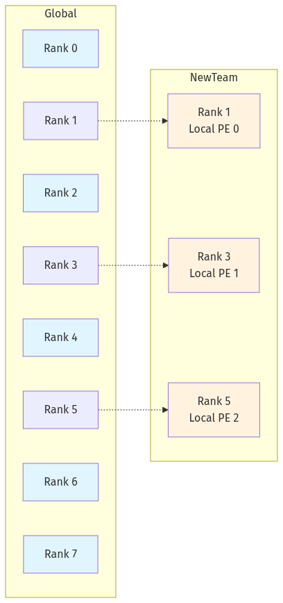

# Introduction to the SHMEM Communicator (Team)

A team is the communicator concept of shmem, and related APIs access it through `team_id`. After initialization, a default global communicator exists, and its `team_id` is `ACLSHMEM_TEAM_WORLD = 0`. The information of a team is stored in team_pools of the state, and team_pools is an array of aclshmemx_team_t. Each aclshmemx_team_t stores information such as the ID of the current team (the index used by team-related APIs), the rank ID of the current process in the team, the start rank in the team, the stride between ranks, and the number of ranks.

**The mype and size stored in aclshmemx_team_t are team-internal information, while the mype and npes stored in aclshmem_device_host_state_t are global information.**
For example, shmem is initialized with 4 ranks, and the first two devices and the last two devices each form a team. In this case, the mype values in the state of the 4 ranks are 0,1,2,3 respectively. The npes value of every rank is 4. However, the mype values in team_pools are 0,1,0,1 respectively, and size is 2.

## Sub-Team Splitting

shmem provides dedicated APIs for splitting sub-teams.

```c++
int aclshmem_team_split_strided(aclshmem_team_t parent_team, int pe_start, int pe_stride, int pe_size, aclshmem_team_t *new_team);
```

parent_team is the parent team. pe_start is the start PE. pe_stride is the stride of each split. pe_size is the number of PEs in the new team. new_team is an output parameter, indicating the team ID of the new team obtained by splitting.

For example, in a scenario where 8 ranks are initialized, call the split API in the following manner:

```c++
aclshmem_team_t new_team;
// Start from the PE with idx 1 in the global communicator, use a stride of 2, and stop after 3 PEs are split.
auto ret = aclshmem_team_split_strided(ACLSHMEM_TEAM_WORLD, 1, 2, 3, &new_team);
```

At this point, the mype values in the state of the 3 PEs in new_team are 1, 3, and 5 respectively, and their mype values in team_pools are 0, 1, and 2 respectively.



## Team Usage

You need to use team-related APIs when an operator needs to run on only some ranks. For example, `aclshmem_team_my_pe(my_team)` returns the mype information of the current rank in my_team, and `aclshmem_my_pe()` returns the global mype information of the current rank. Typically, the team-level mype information is used as the index of the resource array inside an operator, and the global mype is used as the index of the global shared memory address information.

Synchronization APIs also use the team ID. For example, `aclshmem_barrier(aclshmem_team_t tid)` is the intra-team synchronization API provided by shmem.
