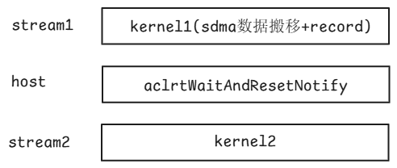

# NotifyWait机制使用说明

> **暂不支持 Ascend950**：当前暂不支持在 Ascend950 平台配套编译运行。

## 环境要求和准备

SDMA功能需要CANN 9.0.0-beta.2及以上版本支持。请参考[CANN版本说明](../../docs/quickstart.md#431-cann-版本说明)下载并安装对应版本的toolkit包；使能SDMA时，还需要安装与toolkit版本和设备类型匹配的ops包。

## example执行说明

1. 在`shmem/`目录编译软件包并安装：

    ```bash
    bash scripts/build.sh -package
    ./install/*/SHMEM_1.0.0_linux-*.run --install
    ```

2. 在`shmem/`目录下编译examples：

    ```bash
    bash scripts/build.sh -examples
    ```

3. 在`shmem/examples/notifywait`目录执行demo:

    ```bash
    bash run.sh -pes ${PES} -type ${TYPES}
    ```

    **参数说明**：
    - PES：指定用于运行的设备（NPU）数量，仅支持2、4、8卡，限定单台机器内。
    - TYPES：指定传输数据类型，当前支持：int，uint8，int64，fp32。

### 容量与AIV限制

- 用例申请`128M * sizeof(T)`字节对称空间，其中输入和结果各需要`PES * 8M * sizeof(T)`字节；经过容量评估，文档支持矩阵为2、4、8卡。实际可用卡数还需满足对称空间和运行环境的容量条件。
- SDMA共享workspace为28 KiB。按A5最大72个AIV/QP计算，notify ID和三组flag区需要`14 KiB + 72 * 4 B + 3 * 72 * 64 B = 28,448 B`，剩余224 B，空间足够。
- 当前kernel启动20个block，按2个subblock计算实际使用40个AIV/QP；底层基础设施和notify数组已按最多72个AIV/QP预留。超过72个vector core的设备当前返回不支持。

## NotifyWait用法说明

### 用法示例



```c++
// 步骤1：
stream1上的kernel1：调用显式QP的sdma接口搬运数据+aclshmemx_sdma_qp_notify_record
// 步骤2：
host:aclrtWaitAndResetNotify(notify_id, stream2, 0)
// 步骤3：
stream2上的kernel2：使用sdma搬运好的数据
```

### 用法说明

aclshmemx_sdma_qp_notify_record中会在指定QP上下发record类型的SQE，后续在host侧等待notify记录完成，再继续执行后续kernel。相比aclshmemx_sdma_qp_quiet使用AIV轮询flag的方式，可及时释放AIV资源。

## aclshmemx_sdma_put_nbi接口用法

除上述显式QP接口外，本示例还演示了不带QP的SDMA接口。二者接口形态接近，区别是不带QP的接口固定使用QP 0，无需传入`qp_idx`，属于单核（单AIV）接口：

```c++
// 异步搬运（固定使用QP 0）
template <typename T>
void aclshmemx_sdma_put_nbi(__gm__ T* dst, __gm__ T* src, __ubuf__ T* buf, uint32_t ub_size,
                            uint32_t elem_size, int pe, uint32_t sync_id);
// 在QP 0上追加notify record，Host侧等待notify_arr[0]即可
template <typename T>
void aclshmemx_sdma_notify_record(__ubuf__ T* buf, uint32_t ub_size, uint32_t sync_id);
```

对应实现为`main.cpp`中的`allgather_sdma_noqp`内核：仅由0号AIV执行，对本PE数据整块搬运（无需按AIV切分），并在QP 0上记录notify：

```c++
// kernel内（仅0号AIV执行）
aclshmemx_sdma_put_nbi(dst, src, tmp_buff, ub_size, size, pe, EVENT_ID0);
aclshmemx_sdma_notify_record(tmp_buff, ub_size, EVENT_ID0);

// host侧：只等待1个notify（QP 0对应notify_arr[0]）
aclrtWaitAndResetNotify(g_state_host.notify_arr[0], stream, 0);
```

### 与显式QP接口的对比

| 对比项 | 不带QP接口 | 显式QP接口 |
| --- | --- | --- |
| 使用的QP | 固定QP 0 | 通过qp_idx指定，可用满已创建的全部QP |
| 执行方式 | 单AIV执行 | 多AIV并发，每个AIV使用独立QP |
| 数据切分 | 无需切分，整块搬运 | 需按AIV切分数据 |
| Host等待 | 仅notify_arr[0] | 每个QP各等待一次notify |
| 适用场景 | 单核简单收发、快速验证 | 多核并发、带宽敏感场景 |

运行`run.sh`时，demo先执行显式QP的多核allgather并校验，再执行不带QP的单核allgather并校验，控制台输出两段校验结果（`after notify_wait`和`after sdma_put_nbi (no QP)`）。
